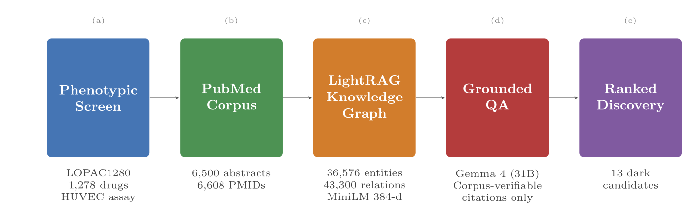

# DrugRAG — Retrieval-Grounded Drug Repurposing from an Angiogenesis Screen

DrugRAG turns a phenotypic angiogenesis screen (1,278 LOPAC compounds, HUVEC
tube-formation assay) into an auditable drug-repurposing discovery tool.
It combines a LightRAG knowledge graph built from 6,500 PubMed abstracts with
PMID-level citation verification, so every claim the LLM makes resolves to a
real, retrievable abstract.

**Live demo:** <https://huggingface.co/spaces/mshz88/DrugRAG>



## What it does

1. **Phase 1 — Hallucination audit.** Asks LLMs to cite sources for
   drug-mechanism questions; quantifies how many citations are fabricated.
2. **Phase 2 — Corpus construction.** Harvests PubMed abstracts for every
   screen drug, building a 6,500-paper local corpus.
3. **Phase 3 — Knowledge graph.** Indexes the corpus with LightRAG (hybrid
   local + global retrieval) into a graph of 36,576 entities and 43,300
   relations.
4. **Phase 4 — Evaluation.** Compares three systems (ungrounded LLM, naive
   RAG, DrugRAG) on a 20-question benchmark measuring verifiable-citation
   rate and cold-start latency.
5. **Phase 5 — Discovery.** Scores all 1,278 drugs, partitions candidates by
   literature novelty, and identifies 13 TRUE-DARK repurposing candidates —
   experimentally active but with zero indexed abstracts.

## Install

```bash
git clone https://github.com/<your-username>/DrugRAG.git
cd DrugRAG
python3 -m venv .venv && source .venv/bin/activate
pip install -r requirements.txt
```

Create a `.env` file in the project root:

```env
OPENROUTER_API_KEY=sk-or-...
PUBMED_EMAIL=your@email.com
NCBI_API_KEY=                    # optional; raises PubMed rate limit to 10 req/s
```

## Usage

### Dashboard (Gradio)

```bash
python dashboard/app.py
```

Opens a multi-tab interface at `http://localhost:7860`:

| Tab | Description |
|-----|-------------|
| Drug Explorer | Per-drug card (screen activity, score, literature status, KG links) with a live-PubMed lookup button |
| Leaderboard | All 1,278 drugs ranked by repurposing score, filterable by direction, PhenoCluster, or literature status |
| Genuinely Understudied | The 13 TRUE-DARK candidates with zero corpus papers |
| Gap Map | Screen activity vs. literature coverage scatter plot |
| KG Explorer | Interactive knowledge-graph subgraph browser |
| Chat (RAG vs plain LLM) | Side-by-side grounded vs. ungrounded answers, each cited PMID badged in-corpus or unverifiable |
| Benchmarks | Citation-audit and evaluation figures and latency measurements |
| About | System overview and per-tab guide |

### Pipeline scripts

```bash
# Phase 1: baseline hallucination audit
python phase1_baseline.py

# Phase 2: build the PubMed corpus
python phase2_corpus.py

# Phase 3: construct the LightRAG knowledge graph
python phase3_knowledge_graph.py

# Phase 4: run the evaluation benchmark
python phase4_evaluation.py

# Phase 5: score drugs and verify novelty
python phase5_build_v5.py
python phase5_pubmed_verify.py
```

### Verification tools

```bash
# Check a numeric claim against on-disk data (expect 13 TRUE-DARK drugs)
python tools/verify_claim.py --csv data/phase5/tables/pubmed_verification_v5.csv \
    --filter "verification == 'TRUE-DARK'" --expect 13

# Verify PMIDs/DOIs in any text against the corpus
python tools/verify_citations.py --file answer.txt --pubmed

# Verify every .bib entry resolves AND its author/title match the real record
python tools/verify_bib.py references.bib --meta
```

## Dependencies

Key libraries (see `requirements.txt` for the full list):

- **[LightRAG](https://github.com/HKUDS/LightRAG)** — hybrid graph + vector retrieval
- **[Gemma 4](https://ai.google.dev/gemma)** (via OpenRouter) — generation model
- **sentence-transformers** (`all-MiniLM-L6-v2`) — local embeddings
- **Gradio** — dashboard framework
- **NetworkX / Plotly** — graph construction and visualization
- **RAGAS** — retrieval-augmented generation evaluation

## Data

The angiogenesis screen data originates from:

> Sailem, H. Z. & Al Haj Zen, A. (2020).
> Morphological landscape of endothelial cell networks reveals a functional
> role of glutamate receptors in angiogenesis.
> *Scientific Reports*, 10, 13829.
> <https://doi.org/10.1038/s41598-020-70440-0>

The compound set is the LOPAC<sup>1280</sup> library. PubMed abstracts were
harvested via the NCBI E-utilities API.

## Results

The grounded system achieves a **100 % verifiable-citation rate** (every cited
PMID resolves to a corpus abstract) vs. **0 %** for the ungrounded model.
Cold-start median latency is 21.6 s (LightRAG hybrid retrieval + Gemma 4).

Of 65 PubMed-verified repurposing candidates, **13 are TRUE-DARK** —
experimentally active in the screen but genuinely understudied (zero
corpus-indexed papers). The three centerpieces are **BNTX** (δ-opioid
antagonist), **Ziprasidone** (D2/5-HT₂A antagonist), and **PHA 767491**
(Cdc7 inhibitor).

See the [live dashboard](https://huggingface.co/spaces/mshz88/DrugRAG) for
interactive exploration of the leaderboard, gap map, and knowledge graph.

## Paper

If you use this code or data, please cite:

> *(BHI 2026 paper — citation to be added upon acceptance.)*

And the foundational screen:

```bibtex
@article{sailem2020screen,
  title     = {Morphological landscape of endothelial cell networks reveals
               a functional role of glutamate receptors in angiogenesis},
  author    = {Sailem, Heba Z. and Al Haj Zen, Ayman},
  journal   = {Scientific Reports},
  volume    = {10},
  pages     = {13829},
  year      = {2020},
  doi       = {10.1038/s41598-020-70440-0}
}
```

## License

MIT — see [LICENSE](LICENSE).

The angiogenesis screen data is used under the Creative Commons Attribution
4.0 International License (CC BY 4.0) of the original publication.

## AI-assistance disclosure

Code development was assisted by AI coding tools (large language models) for
scaffolding, debugging, and documentation, in accordance with IEEE policy on
AI-generated text. All scientific claims, experimental design choices, and
final prose were reviewed and approved by the human author.
