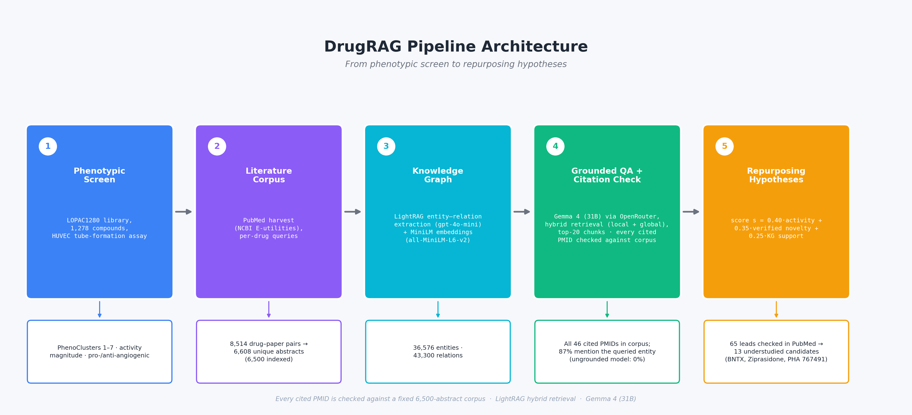

# DrugRAG

Code and data for the IEEE BHI 2026 paper

**DrugRAG: Citation-Verifiable, Knowledge-Graph-Grounded Literature Intelligence for
Drug-Repurposing Hypothesis Generation from a Phenotypic Angiogenesis Screen**

Samiha Rahman\*, Mahmood Alzubaidi\*, Mahmoud Gamal\*, Ayman Al-Haj-Zen, Marco Agus
Hamad bin Khalifa University, Doha, Qatar. \*Equal contribution.
Accepted at the 2026 IEEE-EMBS International Conference on Biomedical and Health
Informatics (BHI 2026).

- **Live system:** <https://mshz88-drugrag.hf.space>
  (Space page: <https://huggingface.co/spaces/mshz88/DrugRAG>)
- **Knowledge-graph index and corpus:** <https://huggingface.co/datasets/mshz88/DrugRAG>

DrugRAG answers drug-mechanism questions only from a fixed corpus of 6,500 PubMed
abstracts, organised as a LightRAG knowledge graph, and checks every PMID it cites
against that corpus. Applied to a phenotypic angiogenesis screen of 1,278 LOPAC
compounds (HUVEC tube formation), it ranks compounds by screen activity, PubMed-verified
literature novelty and graph support, and flags compounds that are active in the
assay but absent or nearly absent from the angiogenesis-specific literature. These are
repurposing hypotheses for follow-up, not validated findings.



## Results reported in the paper

**Citation audit (Table II).** One model (DeepSeek v4 Pro) answered drug-mechanism
questions under three prompt conditions, and every cited PMID was checked against PubMed.

| Condition | Responses | Citations | Unverifiable | Rate [95% CI] |
|---|---|---|---|---|
| Parametric (closed-book) | 27 | 33 | 12 | 36.4% [22, 53] |
| Cite-sources prompt | 26 | 346 | 68 | 19.7% [16, 24] |
| Cite-sources prompt (intensive) | 27 | 506 | 121 | 23.9% [20, 28] |

Asking the model to cite multiplies its citations roughly 15-fold, and a fifth to a third
stay unverifiable.

**Four-level citation check (Table III).** Every PMID emitted on 20 drug-mechanism
questions, graded on the live PubMed record (exists, vascular topic, mentions the entity
the question asks about) and on corpus membership (traceable).

| System | Citations | Exists | Vascular | Mentions queried entity | Traceable to corpus | Latency (s) |
|---|---|---|---|---|---|---|
| Ungrounded Gemma | 16 | 100% | 12.5% | 0.0% | 0% | 15.1 |
| Naive RAG | 36 | 100% | 100% | 77.8% | 100% | 3.7 |
| DrugRAG | 46 | 100% | 95.7% | 87.0% | 100% | 21.6 |

The ungrounded model invents no identifiers here: all 16 of its PMIDs exist, but none
mentions the entity in question. Its 0% is a traceability rate, not a fabrication rate.

**Answer quality (Table IV).** On 553 scoreable RAGAS runs (30 questions, four generator
models), faithfulness rises from 0.570 with flat TF-IDF retrieval to 0.848 with graph
retrieval (combined mode), with non-overlapping 95% intervals. Graph retrieval declines
more questions (56.7% against 19.8%), which lowers answer relevancy.

**Repurposing hypotheses (Tables V and VI).** Of 65 high-priority leads checked against
PubMed, 13 are genuinely understudied, 14 were falsely novel because the corpus missed
their papers, and 38 have partial literature support. The paper discusses three of the 13
in detail: BNTX (delta-opioid antagonist), Ziprasidone (D2/5-HT2A antagonist) and
PHA 767491 (Cdc7 inhibitor). Dropping the knowledge-graph term from the score replaces 21
of the top 50 (Spearman 0.81) but leaves the 13 untouched; over 59 alternative weightings
the ranking keeps a median Spearman of 0.91 with the default.

## Install

```bash
git clone https://github.com/mahmoodphd/DrugRAG.git
cd DrugRAG
python3 -m venv .venv && source .venv/bin/activate
pip install -r requirements.txt
```

The dashboard has its own, smaller requirements file (`dashboard/requirements.txt`),
which is what the Hugging Face Space installs.

Scripts that call a language model or PubMed read keys from a `.env` file in the
repository root:

```env
OPENROUTER_API_KEY=sk-or-...    # generation, audit and graph extraction
OPENAI_API_KEY=sk-...            # RAGAS judge (gpt-4o-mini)
PUBMED_EMAIL=you@example.org     # required by NCBI E-utilities
NCBI_API_KEY=                    # optional; raises the PubMed rate limit
```

## Data

Small inputs and every intermediate result behind the paper's tables are in `data/`.
Three things are too large for GitHub or come from elsewhere:

- **Knowledge-graph index (about 420 MB).** The live Space serves the same index files
  used for the paper. To download them into this repository:

  ```bash
  python -c "from huggingface_hub import snapshot_download; snapshot_download('mshz88/DrugRAG', repo_type='space', allow_patterns='data/phase3/lightrag_working_v2/*', ignore_patterns='*llm_response_cache*', local_dir='.')"
  ```

  The index is also in the Hugging Face dataset
  (<https://huggingface.co/datasets/mshz88/DrugRAG>), inside the archive
  `samiha_backup_20260603.zip` under `data/phase3/lightrag_working_v2/`. That archive also
  holds the harvested abstracts (`data/phase2/papers/`). Rebuilding the graph from them
  needs the paths in `data/phase3/unique_papers.json` pointed at your copy, since they
  record the original machine.
- **Raw screen compound list.** Phases 1 to 4 and `step2_build_v4_candidates.py` read
  `complete_drug_dataset_with_paths_test.csv`, which is at the root of the same archive.
  Copy it into the repository root before running them.
- **Screen data.** The PhenoCluster labels and per-compound morphology features come from
  the supplementary tables of Sailem and Al Haj Zen (2020); see `data/external/`.
- **Language-model calls.** Re-running the audit, the grounded QA or the RAGAS evaluation
  calls models through OpenRouter and costs API credit. Their recorded outputs are in
  `data/`, so every table can be recomputed from them without new language-model calls.
  The citation grading and the novelty checks query PubMed, which is free.

## Reproducing the paper

| Paper item | Command | Result in this repository |
|---|---|---|
| Table I, PhenoClusters | `python tools/refsheet.py --json` | `data/phase5/reference_labels.json` |
| Table II, citation audit | `python run.py phase1 --model deepseek/deepseek-v4-pro` (API) | `data/phase1/hallucination_log.json`, `data/phase1/all_responses.json` |
| Table II intervals, ablation, weight sweep | `python tools/rebuttal_ablation_stats.py` | `data/phase5/tables/rebuttal_ablation_sensitivity.json` |
| Table III, counts and latency | `python tools/run_grounded_eval.py` (API, index) | `data/phase4/eval_grounded_qa.csv`, `eval_grounded_qa_summary.json` |
| Table III, four-level grades | `python tools/rebuttal_citation_relevance.py` (PubMed) | `data/phase4/rebuttal_citation_relevance.json` |
| Table IV, RAGAS runs | `python rerun_v4_entity_boost.py` (API, index) | `data/phase4/eval_results_v4.json`, `ragas_scores_v4.csv`, `ragas_summary_v4.csv` |
| Table IV, printed table | `python generate_v4_ragas_report.py` | `data/phase4/tables/v4_ragas_per_config_metric.md`, `v4_relevancy_disentangled.md` |
| Tables V and VI, ranking and corrections | Phase 5 scripts below | `data/phase5/drug_repurposing_candidates_v5_final.csv`, `data/phase5/tables/v5_final_validation_gate.json` |
| Knowledge-graph size | `full_reindex.py` built the index | `data/phase3/ingestion_coverage_v2.json` |
| Graph path and its PMIDs | `python tools/rebuttal_kg_edge_provenance.py` (index) | `data/phase3/rebuttal_kg_edge_provenance.json` |
| 162 "VEGF" and 314 "endothelial cell" nodes | `python tools/count_kg_surface_forms.py` (index) | printed |
| Fig. 3, gap map | `python phase5_figures_canonical.py` | `data/phase4/figures/v5_final_gap_map.png` |

The 30 RAGAS questions are `DEFAULT_QUESTIONS` in `phase4_evaluation.py` (also listed in
`data/phase3/kg_eval_questions.jsonl`), and the reference answers used for the paper's
RAGAS run are in `data/phase4/ground_truth_v2.json`.
(`data/phase4/ground_truth.json` is an earlier reference set that the paper does not use.)
The 20 grounded-QA questions are in `tools/run_grounded_eval.py`, and the three audit
prompts are in `config.py`.

### Pipeline order

```bash
# Phase 1: citation audit (API)
python run.py phase1 --model deepseek/deepseek-v4-pro

# Phase 2: PubMed corpus (network)
python run.py phase2
python build_unique_papers.py

# Phase 3: knowledge graph (API; the paper's index was built this way)
python full_reindex.py

# Knowledge-graph support term for every drug (needs the index;
# drug-name normalisation comes from step1_normalize_remeasure.py)
python step2_build_v4_candidates.py

# Phase 5: screen activity, ranking, PubMed checks
python phase5_phenocluster_join.py
python phase5_activity_magnitude.py
python phase5_build_v5.py
python phase5_pubmed_verify.py      # network
python phase5_real_novelty.py       # network
```

### A note on the Phase 1 prompt conditions

In the code the three audit conditions are named `parametric`, `standard_search` and
`deep_search`. In the paper they are *Parametric (closed-book)*, *Cite-sources prompt* and
*Cite-sources prompt (intensive)*. The two cite-sources conditions request OpenRouter's
web-search tool, but no web sources came back for any of the 80 responses
(`n_web_sources` is 0 throughout `data/phase1/all_responses.json`). All three conditions
are therefore effectively closed-book and differ only in how strongly the model is told
to cite, as the paper states.

## Dashboard

```bash
python dashboard/app.py
```

This opens the interface at `http://localhost:7860`. The Chat and Knowledge Graph tabs
need the index (see Data) and an OpenRouter key.

| Tab | What it shows |
|---|---|
| Drug Explorer | Per-drug card: screen activity, score, literature status and graph links, with a live PubMed lookup |
| Leaderboard | All 1,278 compounds ranked by repurposing score, filterable by direction, PhenoCluster or literature status |
| Genuinely Understudied | The 13 compounds active in the screen but absent or nearly absent from the angiogenesis-specific literature |
| Gap Map | Screen activity against angiogenesis literature coverage |
| KG Explorer | Interactive knowledge-graph neighbourhood for any drug |
| Chat (RAG vs plain LLM) | Grounded and ungrounded answers side by side; each cited PMID is green if it is in the corpus and red if it is not (red does not mean the paper is fake) |
| Benchmarks | Citation-audit and answer-quality figures and latency |
| About | System overview and a guide to each tab |

## Checking claims and citations

```bash
# Check a number against the data on disk (13 understudied compounds)
python tools/verify_claim.py --csv data/phase5/tables/pubmed_verification_v5.csv \
    --filter "verification == 'TRUE-DARK'" --expect 13

# Is each PMID or DOI in a text in the corpus? (--pubmed also asks PubMed)
python tools/verify_citations.py --file answer.txt --pubmed

# Does every BibTeX entry resolve, with matching authors and title?
python tools/verify_bib.py refs.bib --meta
```

See `tools/README.md` for the full list.

## Citation

If you use this code or data, please cite the paper:

```bibtex
@inproceedings{rahman2026drugrag,
  title     = {{DrugRAG}: Citation-Verifiable, Knowledge-Graph-Grounded Literature
               Intelligence for Drug-Repurposing Hypothesis Generation from a
               Phenotypic Angiogenesis Screen},
  author    = {Rahman, Samiha and Alzubaidi, Mahmood and Gamal, Mahmoud and
               Al-Haj-Zen, Ayman and Agus, Marco},
  booktitle = {2026 IEEE-EMBS International Conference on Biomedical and Health
               Informatics (BHI)},
  year      = {2026},
  note      = {Accepted}
}
```

and the screen it builds on:

```bibtex
@article{sailem2020screen,
  title     = {Morphological landscape of endothelial cell networks reveals
               a functional role of glutamate receptors in angiogenesis},
  author    = {Sailem, Heba Z. and Al Haj Zen, Ayman},
  journal   = {Scientific Reports},
  volume    = {10},
  pages     = {13829},
  year      = {2020},
  doi       = {10.1038/s41598-020-70440-0}
}
```

The compound set is the LOPAC<sup>1280</sup> library. Abstracts were retrieved through the
NCBI E-utilities API.

## License

MIT, see [LICENSE](LICENSE). The screen data is used under the Creative Commons
Attribution 4.0 International License (CC BY 4.0) of the original publication.

## AI-assistance disclosure

Code development was assisted by AI coding tools (large language models) for scaffolding,
debugging and documentation, in accordance with IEEE policy on AI-generated text. All
scientific claims, experimental design choices and final prose were reviewed and approved
by the authors.
